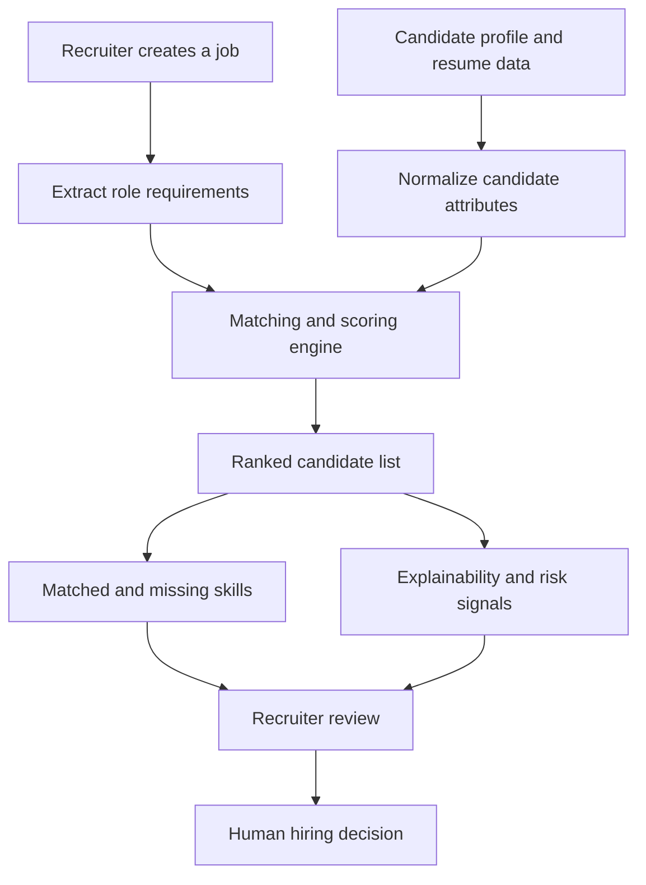
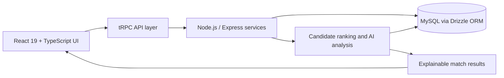

<div align="center">
  <h1>Talent AI</h1>
  <p><strong>Explainable AI Hiring Intelligence</strong></p>
  <p>Structured candidate evaluation with transparent, job-relevant recommendations.</p>
  <p>
    
    
    
  </p>
</div>

---

## Overview

Talent AI is a recruitment intelligence platform that helps recruiters organise job openings, review candidate profiles and compare applicants against role requirements. It combines structured candidate data, configurable scoring signals and LLM-assisted analysis to produce recommendations that are easier to inspect than a single unexplained match score.

The goal is to support recruiter judgement—not replace it. A recommendation should help a recruiter understand relevant strengths, missing requirements and potential concerns, while leaving the final hiring decision with a human reviewer.

## Key capabilities

- Job creation and management
- Candidate profile and resume information management
- Candidate search, filtering and ranking
- Job-to-candidate matching with a weighted scoring model
- Matched and missing skill summaries
- Explainable recommendation notes and risk signals
- Recruiter dashboard and hiring analytics
- Excel export for downstream review
- LLM-assisted job requirement extraction using structured output and fallback handling
- A structured, LLM-free ranking path for deterministic candidate scoring

## How it works



## Scoring approach

The documented weighted model combines six dimensions:

| Dimension | Weight |
|---|---:|
| Skills | 40% |
| Experience | 25% |
| Projects | 15% |
| Education | 10% |
| Certifications | 5% |
| Activity | 5% |

The score is intended as a structured comparison aid. It is not a validated psychometric measure, a guarantee of job performance, or an automated hiring decision. Recruiters should review the underlying evidence and apply consistent, job-related criteria.

## Architecture



## Technology stack

- **Frontend:** React 19, TypeScript, Vite, Tailwind CSS, shadcn/ui
- **Backend:** Node.js, Express, TypeScript, tRPC
- **Database:** MySQL, Drizzle ORM
- **AI integration:** OpenAI-compatible LLM API, structured JSON extraction and fallback logic
- **Product features:** candidate ranking, job management, analytics and spreadsheet export

## Getting started

The application is located in the `talent-ai project/` directory. It uses pnpm (declared by the package metadata), MySQL and environment-based service configuration. Review [`talent-ai project/PROJECT_DOCUMENTATION.md`](talent-ai%20project/PROJECT_DOCUMENTATION.md) and `server/_core/env.ts` for the exact configuration required by your checkout.

```bash
cd "talent-ai project"
pnpm install

# Configure the required MySQL and LLM settings in your local environment
# using the variable names defined in server/_core/env.ts.

pnpm run db:push
pnpm run dev
```

Other available scripts include `pnpm run check`, `pnpm test`, and `pnpm run build`. Do not commit API keys, database passwords or personal candidate data.

## Responsible use

Recruitment is a high-impact domain. Talent AI should be used as decision support only:

- Keep a human recruiter responsible for every hiring decision.
- Review source evidence rather than relying only on a generated explanation or score.
- Apply consistent, role-related criteria to every applicant.
- Do not use protected characteristics or proxies for them in scoring.
- Validate ranking behaviour with representative, consented and appropriately governed data before any real hiring use.
- Protect resumes and candidate information with appropriate access controls, retention rules and security review.
- Monitor for disparate impact and investigate unexpected ranking patterns.

The current project should be treated as a development/demo platform unless and until deployment, privacy, security, fairness and operational controls are independently validated.

## Repository documentation

For implementation details, database schema, API procedures, user roles, scoring calculations, security notes and development workflow, see [`talent-ai project/PROJECT_DOCUMENTATION.md`](talent-ai%20project/PROJECT_DOCUMENTATION.md).

## Future directions

- More rigorous evaluation of ranking quality and calibration
- Bias and disparate-impact testing with documented governance
- Candidate consent, retention and deletion workflows
- Interview scheduling and recruiter collaboration
- Integrations with approved HR systems
- Expanded analytics and auditability

---

<div align="center"><strong>Talent AI — Make hiring decisions more informed, transparent and human-led.</strong></div>
